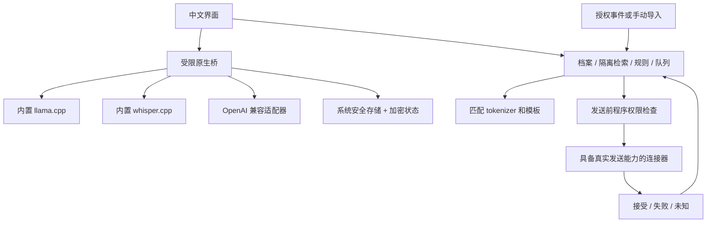

# 架构与边界

React / TypeScript 复用中文 UI 和业务。Android 为 Capacitor + Java + C++ JNI，Windows 为 Electron 隔离 preload/main。原生层负责推理、大文件、资源、鉴权和安全存储。UI 不具备任意 shell 或任意文件路径权限。

## 推理与 API

默认固定 llama.cpp b11429 / d81235049384534c167caea52b85a694f6103d14，支持 qwen35。Android 默认为 default-model.json 的 HauhauCS 2B Q4_K_M，Windows 默认为 default-model.windows.json 的 HauhauCS 9B Q4_K_M；各自固定 revision、SHA 和匹配 projector。原生 modelStatus 提供本平台 defaultModel 元数据，UI 按实际平台显示。Android 编入 ARM64 CPU 库，Windows 附带应用管理的 CPU 引擎并只监听内部回环。使用者不需独立服务器。

12,800 是完整预算：模板、规则、档案、记忆、历史、当前输入和输出。tokenize/infer 使用同一实际模板；超限裁剪历史，保留必要规则和当前消息。引擎计数失败则停止，不用字符估算冒充验收。一次一个推理任务，按需加载释放；多模态组件分开管理。

本地图片通过 mtmd 与匹配 projector 分析，本地语音通过 Whisper Base 多语言转写；两条路径已实现，并使用真实制品在 Linux 云机验证。媒体结果存为原消息的 analysisText，保留原文、类型、会话和消息 ID；用户检查、修正并确认后进入文字回复，不能直接成为本人事实。组件准备与目标设备验收分别记录。

供应商预设仅在界面，协议层不绑定 DeepSeek、豆包或千问。API 需能力和授权检查，本地模式没有隐式回退。密钥不入日志、URL或导出，TLS 保留，重定向不传鉴权。

## 风格、隔离与权限

Scope 含账号、会话和联系人。私有记忆及导入示例必须匹配，本人明确共享才跨会话。记忆带来源、更新时间、确认及失效字段。使用低内存词项检索，不在手机训练权重，不把 AI 草稿自动设为正确样本。

聊天、图片文字和转写均是数据，不能改变权限。模型只生成草稿，程序独立检查敏感内容、模态确认、授权、范围、白名单、时段、冷却、负责人、暂停、接管及上下文版本。

## 队列与恢复

队列序列化消息、草稿、contextVersion、seen／answered、inFlight、冷却和接管范围，账号／会话内按事件 ID 去重。permitSend 原子预留，**先持久化，再调用连接器**。平台明确接受才 markAccepted；超时是 unknown。崩溃恢复 inFlight 转 unknown，不盲目重发；新消息合并也不能绕过未决结果。档案或记忆改变时更新上下文版本并取消旧的未发送草稿，保留发送中或结果未知的实际状态。

当前 UI 没有真实发送权限；QQ 模块仅解析官方机器人事件、规划被动回复并测 fixture。没有个人账号接管或网络联调。单设备门禁尚不等于跨设备租约协调，真实多设备自动发送保持关闭。

## 存储初始化

首版为版本化加密 JSON 状态，不是关系数据库，不需 SQL。首次启动初始化档案、建议规则和明确演示消息；原生安全存储自动创建文件，串行原子替换。Android Keystore AES-GCM，Windows safeStorage；后端不可用时失败，不保存明文。既有数据读取或解密失败时关闭自动保存，保留原文件，本次更改仅在内存。

迁移导出使用 PBKDF2-SHA256 310,000 次 + AES-256-GCM，每次随机 salt/nonce，不含密钥。分别限制配置正文和加密信封：正文上限 16 MiB，导入信封上限 32 MiB。导入检验版本后暂停并关闭自动授权，未决发送不能改为盲重试。原始记录不随上下文裁剪删除；保存期限清理到期正文时保留未决发送引用及无正文去重标识。

构建成功、云检查、Windows 运行、8GB Android 和平台联调是独立证据，逐项见 VALIDATION。macOS / iOS 不在本次范围。
